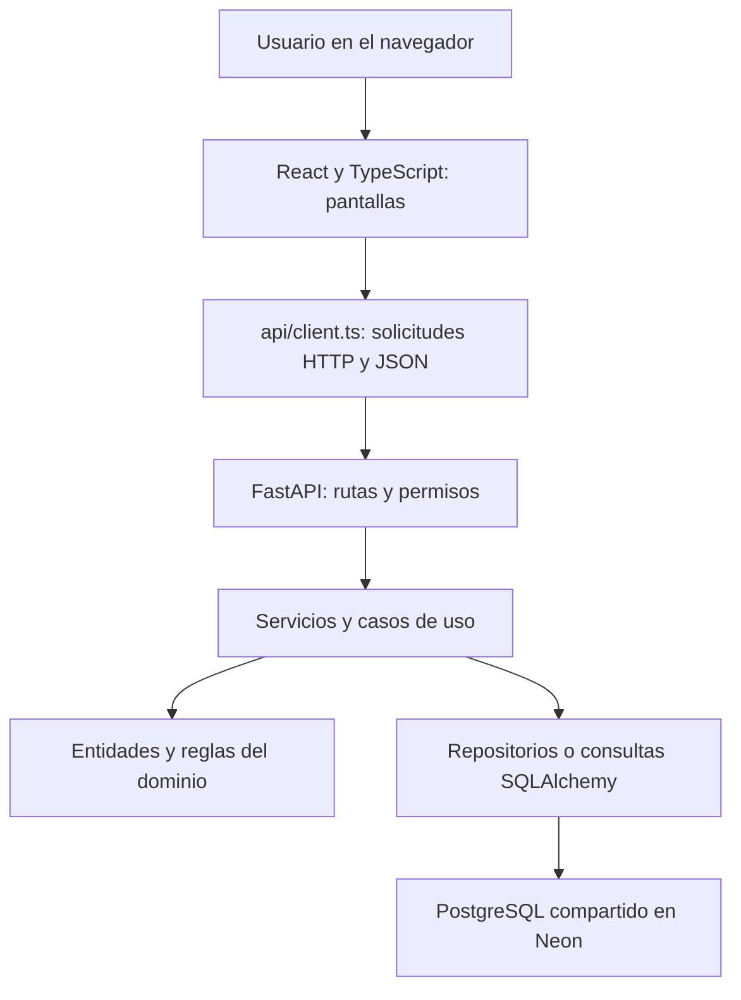

# Cómo explicar el proyecto y su base de datos

## 1. Qué decir al comenzar

“Nuestro sistema administra préstamos de equipos de la EPCC. Permite registrar usuarios, consultar el catálogo, reservar un equipo, confirmar la reserva, registrar la entrega y registrar la devolución. Conserva los datos en PostgreSQL compartido en Neon; también admite SQLite para pruebas locales.”

Reserva significa separar un intervalo de fechas. Préstamo significa que el equipo ya se entregó físicamente. Son operaciones y tablas diferentes.

## 2. Cómo se conectan las partes



La respuesta vuelve hacia la pantalla como JSON. React actualiza lo que se muestra. El navegador no abre directamente el archivo SQLite.

Frontend: interfaz en el puerto 5173. Backend: servidor en el puerto 8000. Base compartida: PostgreSQL en Neon. En modo SQLite se utiliza un archivo local.

## 3. Por qué está distribuido así

Se organiza primero por responsabilidad del negocio: `usuarios`, `recursos` y `prestamos`. Dentro se separan tareas:

| Carpeta | Qué significa | Ejemplo para decir en clase |
| --- | --- | --- |
| `domain` | Entidades, estados y reglas del negocio; también contratos de repositorios. | Una reserva tiene fechas y estado. |
| `application` | Coordina una operación que puede necesitar varias entidades. | Reservar exige revisar usuario, equipo y fechas ocupadas. |
| `infraestructure` | Almacenamiento concreto con SQLAlchemy y modelos de tablas. | Guardar o buscar una reserva en SQLite. |
| `presentation` | Entrada HTTP: rutas, validación de solicitudes y permisos. | Recibir `POST /reservas/`. |

“Esta separación ayuda a ubicar los cambios y probar las reglas. Si cambia una pantalla, no debería obligarnos a reescribir las reglas de reserva.”

Es una organización por capas con ideas de puertos y adaptadores. No es una separación estricta en todo el código: `PrestamoService` consulta modelos SQLAlchemy directamente y autenticación define sus modelos en un archivo de rutas. Son decisiones actuales que se pueden refactorizar.

## 4. Archivos principales de la raíz

| Archivo | Función |
| --- | --- |
| `main.py` | Crea FastAPI, importa modelos, crea tablas faltantes, prepara roles, configura CORS, errores y conecta las rutas. |
| `backend/database.py` | Lee configuración, resuelve la ubicación de SQLite, crea motor y sesiones de base de datos. |
| `.env` | Configuración local, incluida `DATABASE_URL` si está definida. No mostrar secretos al exponer. |
| `.gitignore` | Excluye bases `.db`, `.env`, dependencias y archivos generados. Por eso clonar no copia usuarios. |
| `requirements.txt` | Dependencias Python. |
| `README.md` | Descripción general, requisitos y organización del proyecto. |
| `sistema_prestamo.db` | Datos persistidos de esta instalación. No es código fuente. |
| `scripts/respaldar_bd.py` | Crea y verifica una copia de la base configurada. |
| `scripts/ver_bd.py` | Lee SQLite sin modificarlo y genera una vista HTML local de estructura y datos. |
| `docs/GUIA_PRESENTACION.md` | Recorrido funcional y comandos para la demostración. |
| `tests/test_account_flow.py` | Pruebas de cuentas, permisos y operaciones relacionadas. |
| `tests/test_reservation_flow.py` | Pruebas del flujo de reservas. |
| `tests/test_loan_flow.py` | Pruebas de entregas y préstamos. |
| `tests/test_return_flow.py` | Pruebas de devoluciones. |

`backups` guarda copias; `artifacts` contiene ensayos, capturas y reportes; `uploads` guarda archivos subidos cuando se utiliza. `__pycache__`, `.venv` y `node_modules` son archivos del entorno. Los `__init__.py` identifican paquetes Python y no son pantallas ni tablas.

## 5. Backend: usuarios, archivo por archivo

Rutas relativas a `backend/usuarios/`:

| Archivo | Qué hace |
| --- | --- |
| `domain/usuario.py` | Define usuario, estudiante, profesor, administrativo y estados de usuario. |
| `domain/rol.py` | Define roles, niveles y comportamiento del rol. |
| `application/registrar_usuario.py` | Coordina el registro administrativo; valida datos, duplicados, tipo y rol. |
| `application/asignar_rol.py` | Coordina asignar un rol a un usuario. |
| `application/gestionar_perfil.py` | Operaciones de perfil, estado, eliminación y credibilidad. |
| `infraestructure/models.py` | Tablas `usuarios` y `roles`. Los tipos de usuario comparten la tabla `usuarios`. |
| `infraestructure/usuario_repository.py` | Busca y guarda usuarios y roles; convierte entre entidades y modelos cuando corresponde. |
| `infraestructure/seed_roles.py` | Inserta roles iniciales faltantes; no crea cuentas de personas. |
| `presentation/auth_routes.py` | Registro público, login, logout, perfil actual, verificación de sesión y administrador. También define las tablas `cuentas` y `sesiones`. |
| `presentation/usuario_routes.py` | API de gestión administrativa de usuarios. |
| `presentation/rol_routes.py` | API de roles. |
| `presentation/matricula_routes.py` | Subida y lectura de constancias PDF locales. |

El registro público y el administrativo son entradas distintas. El público admite estudiante o profesor; no permite elegir libremente ser administrador.

Una entidad de dominio representa conceptos del negocio. Un modelo SQLAlchemy representa cómo se almacenan. Ejemplo: `Usuario` y `UsuarioModel` tienen responsabilidades diferentes aunque compartan datos.

## 6. Backend: recursos

Rutas relativas a `backend/recursos/`:

| Archivo | Qué hace |
| --- | --- |
| `domain/objeto.py` | Entidad equipo/objeto y comportamiento como determinar si se puede reservar. |
| `domain/categoria.py` | Entidad categoría. |
| `domain/enums.py` | Valores permitidos de disponibilidad y estado físico. |
| `domain/objeto_repository.py` | Contrato de las operaciones de almacenamiento de equipos. |
| `domain/categoria_repository.py` | Contrato para categorías. |
| `application/objeto_service.py` | Coordina operaciones y validaciones de equipos. |
| `infraestructure/models.py` | Tablas `objetos` y `categorias`. |
| `infraestructure/sql_objeto_repository.py` | Implementa consultas y escrituras de equipos. |
| `infraestructure/sql_categoria_repository.py` | Implementa almacenamiento de categorías. |
| `infraestructure/seed_demo.py` | Agrega categorías y equipos de ejemplo faltantes; no crea usuarios. |
| `presentation/objeto_routes.py` | API del catálogo e inventario. |
| `presentation/categoria_routes.py` | API de categorías. |

Estado físico y disponibilidad son distintos: un equipo puede estar BUENO y PRESTADO. La primera propiedad describe su condición; la segunda, si está disponible para operar.

## 7. Backend: reservas, préstamos y devoluciones

Rutas relativas a `backend/prestamos/`:

| Archivo | Qué hace |
| --- | --- |
| `domain/reserva.py` | Entidad reserva, estados y transiciones. Es el estado de reserva importado por el flujo actual. |
| `domain/reserva_repository.py` | Contrato para guardar, buscar y listar reservas y detectar cruces. |
| `domain/Prestamo.py` | Entidad préstamo; incluye comportamiento de devolución y vencimiento. |
| `domain/devolucion.py` | Entidad devolución y validación de su información. |
| `domain/enums.py` | Estados del módulo; también hay definiciones para conceptos previstos. |
| `domain/solicitudPrestamo.py` | Modelado de solicitud y aprobación; no es una etapa adicional integrada al recorrido actual. |
| `domain/regla_de_prestamo.py` | Modelado de políticas; no hay una configuración administrativa integrada de estas políticas. |
| `domain/historialPrestamo.py` | Modelado de eventos de historial; el historial visible actual se obtiene de los préstamos guardados, sin una tabla de estos eventos. |
| `application/ports.py` | Contrato de consulta de usuarios para el servicio de reservas. |
| `application/reserva_service.py` | Revisa usuario activo, equipo reservable, fechas y cruces; coordina cambios de reserva. |
| `application/prestamo_service.py` | Registra entrega/devolución, actualiza equipo y préstamo en una transacción y prepara datos para responder. |
| `infraestructure/models.py` | Tablas `reservas`, `prestamos` y `devoluciones`; incluye restricciones contra duplicados. |
| `infraestructure/sql_reserva_repository.py` | Persistencia de reservas y escritura condicional para impedir reservas simultáneas cruzadas. |
| `presentation/reserva_routes.py` | Endpoints para crear, consultar, confirmar, cancelar y finalizar reservas. Arma el servicio con sus repositorios. |
| `presentation/prestamo_routes.py` | Endpoints de entrega, listado y devolución; la administración registra operaciones físicas. |

`backend/shared/errors.py` define errores compartidos. `main.py` los traduce a respuestas HTTP: por ejemplo, conflicto 409 o recurso inexistente 404.

En `backend/control/`, `domain/enums.py`, `domain/notificacion.py` y `domain/penalizacion.py` modelan estados y entidades; `application/registrar_notificacion.py` y `application/registrar_penalizacion.py` contienen funciones previstas para registrar esos conceptos. Las rutas de ejemplo sin implementación se retiraron durante la limpieza. No presentar este módulo como un servicio de notificaciones o sanciones automáticas ya operativo.

## 8. Frontend: qué hace cada grupo de archivos

Rutas relativas a `frontend/`:

| Archivo | Qué hace |
| --- | --- |
| `index.html` | Documento base con el elemento donde React monta la aplicación. |
| `src/main.tsx` | Punto de entrada React: monta `Login`. |
| `src/Login.tsx` | Inicio de sesión, acceso al registro y entrada al espacio de trabajo. |
| `src/Workspace.tsx` | Menú, resumen y selección de pantalla según usuario y permisos. |
| `src/usuario/RegistroCuentaForm.tsx` | Formulario de registro público. |
| `src/usuario/UsuarioPage.tsx` | Administración de usuarios. |
| `src/usuario/MiPerfilPage.tsx` | Perfil del usuario actual y constancia. |
| `src/usuario/usuarioApi.ts` | Operaciones administrativas de usuarios, roles, credibilidad y PDF. Reutiliza el cliente HTTP. |
| `src/pages/catalogo/CatalogoPage.tsx` | Listado de equipos, filtros, búsqueda y acceso a reserva. |
| `src/pages/catalogo/EquipoForm.tsx` | Formulario de alta y edición de equipos. |
| `src/pages/reservas/ReservasPage.tsx` | Crear y listar reservas; acciones según rol y estado. |
| `src/pages/prestamos/PrestamoPage.tsx` | Entregas, listado e historial de préstamos. |
| `src/pages/prestamos/DevolucionForm.tsx` | Captura estado físico y observaciones de devolución. |
| `src/api/client.ts` | Dirección del backend, `fetch`, JSON, envío de cookie y manejo común de errores. |
| `src/api/auth.ts` | Llamadas HTTP de autenticación y perfil. |
| `src/api/usuarios.ts` | Tipos y consultas de usuarios compartidos. |
| `src/api/objetos.ts` | Llamadas del catálogo y categorías. |
| `src/api/reservas.ts` | Llamadas de reservas. |
| `src/api/prestamos.ts` | Llamadas de entrega, consulta y devolución. |
| `src/*.css` y CSS junto a cada pantalla | Diseño: distribución, colores, formularios y adaptación a celulares. No guardan datos. |
| `public/*` | Imágenes e iconos servidos por su ruta. |
| `package.json` | Dependencias y comandos de desarrollo, revisión y compilación. |
| `package-lock.json` | Versiones resueltas para instalar dependencias de forma consistente. |
| `vite.config.ts` | Configuración de Vite para desarrollo y compilación. |
| `tsconfig*.json` | Configuración de comprobación de tipos TypeScript. |

Los `.tsx` combinan lógica de interfaz y elementos visuales; los `.ts` de `api` reúnen la comunicación; los `.css` dan presentación visual.

## 9. Ejemplo completo: el botón Reservar

Abre estos archivos en este orden para demostrar que están conectados:

1. `frontend/src/pages/reservas/ReservasPage.tsx`: recoge equipo y fechas.
2. `frontend/src/api/reservas.ts`: construye la llamada de reserva.
3. `frontend/src/api/client.ts`: manda HTTP y JSON al backend con la cookie de sesión.
4. `main.py`: registra el router de reservas y exige autenticación.
5. `backend/prestamos/presentation/reserva_routes.py`: recibe `POST /reservas/`, valida el cuerpo y toma la identidad de la sesión. `get_reserva_service` conecta el servicio con repositorios de reservas, objetos y usuarios usando la sesión de base.
6. `backend/prestamos/application/reserva_service.py`: comprueba fechas, usuario activo, equipo y cruces.
7. `backend/prestamos/domain/reserva.py`: representa la reserva y sus reglas propias.
8. `backend/prestamos/infraestructure/sql_reserva_repository.py`: escribe el registro, comprueba nuevamente cruces en la escritura y confirma con `commit`.
9. `backend/prestamos/infraestructure/models.py`: define las columnas de `reservas`.
10. La respuesta vuelve a React y se actualiza la lista. Abre la base para mostrar la fila creada.

No necesitas leer cada línea. Explica qué recibe cada parte, qué decide y a quién llama.

## 10. La conexión exacta a la base

Abre `backend/database.py` y explica:

| Elemento | Explicación sencilla |
| --- | --- |
| `PROJECT_ROOT` | Localiza la raíz del proyecto a partir de la ubicación del archivo Python. |
| `load_dotenv(...)` | Carga variables del `.env` local. |
| `os.getenv("DATABASE_URL", "sqlite:///./sistema_prestamo.db")` | Usa la conexión configurada o SQLite por defecto. |
| `make_url` y ajuste de ruta | Si SQLite tiene una ruta relativa, la fija respecto a la raíz para usar el mismo archivo desde distintas carpetas. |
| `create_engine(...)` | Prepara el acceso a la base mediante SQLAlchemy. |
| `check_same_thread=False` | Permite el uso requerido por el servidor con SQLite; por sí solo no resuelve conflictos de escritura. |
| `SessionLocal` | Fábrica de sesiones de trabajo con la base. |
| `Base` | Base común que usan las clases de modelos para declarar tablas. |
| `get_db()` | Abre una sesión para la solicitud y la cierra al terminar usando `finally`. |

En las rutas, `Depends(get_db)` pide a FastAPI esa sesión. `db.add` prepara un registro; `flush` envía cambios sin confirmar la transacción; `commit` confirma; `rollback` revierte cambios pendientes; `refresh` vuelve a leer el registro.

En `main.py`, `Base.metadata.create_all(bind=engine)` crea tablas que falten. No equivale a migraciones completas ni carga usuarios.

La configuración actual usa Neon. `sistema_prestamo.db` conserva los datos locales anteriores. La configuración del equipo se explica en `docs/BASE_COMPARTIDA.md`.

## 11. Tablas y relaciones

| Tabla | Qué almacena | Conexión principal |
| --- | --- | --- |
| `roles` | Nombre, permisos y nivel del rol. | Un rol puede corresponder a muchos usuarios. |
| `usuarios` | Identidad, tipo, estado, credibilidad y campos de perfil. | `rol_id` apunta a `roles.id`. |
| `cuentas` | Hash de la contraseña. | `usuario_id` identifica al usuario; como máximo una cuenta por usuario. |
| `sesiones` | Hash del token de sesión y expiración. | `usuario_id` identifica al usuario. |
| `categorias` | Agrupaciones de equipos y estado activo. | Referenciada por `objetos.categoria_id`. |
| `objetos` | Equipos, categoría, condición y disponibilidad. | Se identifica en reservas y préstamos mediante su `id`. |
| `reservas` | Usuario, equipo, fechas y estado de la reserva. | `usuario_id` y `objeto_id` enlazan lógicamente con sus registros. |
| `prestamos` | Entrega, responsables, fechas, estado y nombres para historial. | `reserva_id` es único; también identifica usuario y equipo. |
| `devoluciones` | Recepción, condición física y observaciones. | `prestamo_id` apunta a `prestamos.id` y es único. |

Relaciones del negocio:

```text
roles       1 ─── N usuarios
usuarios    1 ─── 0..1 cuentas
usuarios    1 ─── N sesiones
categorias  1 ─── N objetos
usuarios    1 ─── N reservas N ─── 1 objetos
reservas    1 ─── 0..1 prestamos
prestamos   1 ─── 0..1 devoluciones
```

No todos esos enlaces tienen `ForeignKey` declarado: varios son identificadores enteros cuya coherencia se comprueba desde la aplicación. Los modelos declaran claves foráneas para usuario–rol, cuenta–usuario, sesión–usuario y devolución–préstamo. Además, en SQLite la aplicación no activa explícitamente `PRAGMA foreign_keys=ON`, así que declarar una clave no basta para afirmar que SQLite está comprobándola en cada conexión. Es una mejora posible.

En usuarios se usa una sola tabla con un discriminador `tipo`. Por eso un estudiante tiene campos de profesor o administrativo en NULL: no corresponden a su tipo. NULL significa ausencia de valor, no cero.

La fila compartida de Luzied representa un usuario estudiante activo con credibilidad 100 y `rol_id=2`. El nombre de ese rol se comprueba consultando `roles`; no se deduce solo del número. Esa fila no demuestra por sí sola que exista su cuenta de acceso: hay que consultar `cuentas`.

## 12. Abrir y mostrar la base

**Neon actual:** abre la conexión PostgreSQL en DBeaver y navega a `Schemas → public → Tables`. Las consultas SELECT de abajo también sirven allí. Para listar tablas usa `SELECT table_name FROM information_schema.tables WHERE table_schema = 'public';`. Los comandos `PRAGMA` son exclusivos de SQLite.

**SQLite anterior:** el visor que sigue aplica solo si `DATABASE_URL` apunta a SQLite. Mantén la conexión de Neon para la exposición compartida.


Desde la raíz del proyecto ejecuta:

```powershell
python -X utf8 scripts/ver_bd.py
```

Abre una vista local en el navegador con tablas, estructura, cantidades y hasta 50 filas por tabla. Lee la base con `mode=ro`; omite valores de hash de contraseña y token. El HTML es una fotografía: después de hacer una operación en la aplicación, vuelve a ejecutar el comando y recarga la página. El reporte queda en `artifacts/base_datos_presentacion.html`; contiene datos personales de la instalación, así que no lo subas a Git.

Para explorar con una herramienta SQLite que ya tengas instalada, abre el archivo `sistema_prestamo.db` y utiliza su sección de datos o consultas SQL. No abras el archivo como texto: es un formato binario.

Consultas de lectura para explicar:

```sql
-- Tablas existentes.
SELECT name FROM sqlite_master WHERE type = 'table' ORDER BY name;

-- Columnas de usuarios.
PRAGMA table_info(usuarios);

-- Usuarios con el nombre real del rol.
SELECT u.id, u.nombre, u.correo_institucional, u.tipo, u.estado,
       u.credibilidad, r.nombre AS rol
FROM usuarios u
LEFT JOIN roles r ON r.id = u.rol_id;

-- Comprobar cuenta sin mostrar el hash.
SELECT u.nombre, CASE WHEN c.usuario_id IS NULL THEN 'Sin cuenta'
                     ELSE 'Con cuenta' END AS acceso
FROM usuarios u
LEFT JOIN cuentas c ON c.usuario_id = u.id;

-- Reservas con nombres en lugar de números.
SELECT r.id, u.nombre AS usuario, o.nombre AS equipo,
       r.fecha_inicio, r.fecha_fin, r.estado
FROM reservas r
LEFT JOIN usuarios u ON u.id = r.usuario_id
LEFT JOIN objetos o ON o.id = r.objeto_id
ORDER BY r.id DESC;

-- Entregas y devoluciones.
SELECT p.id, p.usuario_nombre, p.objeto_nombre, p.estado,
       p.fecha_devolucion_prevista, p.fecha_devolucion_real,
       d.estado_fisico, d.observaciones
FROM prestamos p
LEFT JOIN devoluciones d ON d.prestamo_id = p.id
ORDER BY p.id DESC;
```

`JOIN` combina filas usando sus identificadores. `LEFT JOIN` conserva la fila de la izquierda aunque no exista un registro relacionado; sirve para ver préstamos aún sin devolución.

## 13. Login explicado sin confundir términos

1. La pantalla envía correo y contraseña al backend.
2. El backend busca `usuarios` y su registro en `cuentas`.
3. Verifica el hash PBKDF2 con SHA-256, sal aleatoria y 600000 iteraciones. No almacena la contraseña original ni la recupera descifrándola.
4. Crea un token aleatorio; guarda su hash en `sesiones` con vigencia de ocho horas.
5. Devuelve una cookie `epcc_session`, marcada HttpOnly.
6. `client.ts` incluye cookies con `credentials: "include"`. El backend valida la sesión en las solicitudes siguientes.
7. Las operaciones administrativas verifican que el rol se llame `ADMIN`.

No usa JWT en este flujo. Ocultar botones ayuda a la interfaz, pero el control de permisos real también está en el backend.

## 14. Orden recomendado para exponer en 12–15 minutos

1. **Problema y objetivo (1 min).** Qué administra el sistema y para quién.
2. **Demostración funcional (4 min).** Catálogo → reserva → confirmación → entrega → devolución. Para entregar hoy, la reserva debe incluir hoy.
3. **Arquitectura (2 min).** Muestra carpetas y el recorrido de una solicitud. Explica las cuatro capas.
4. **Código conectado (3 min).** Sigue el ejemplo del botón Reservar. Abre `main.py` y `database.py`.
5. **Base de datos (3 min).** Muestra usuarios/roles, reserva creada, préstamo y devolución. Explica IDs, relaciones y persistencia.
6. **Pruebas y pendientes (1 min).** Muestra la carpeta `tests`. Distingue lo implementado del modelado pendiente.

Antes de practicar, respalda con `python -X utf8 scripts/respaldar_bd.py`. El recorrido funcional detallado y comandos para arrancar los servidores están en `docs/GUIA_PRESENTACION.md`. Sus cuentas de ejemplo corresponden a la base local original, no a todas las instalaciones.

## 15. Preguntas que puede hacer la profesora

**¿Por qué tantos archivos?** Porque cada uno reúne una responsabilidad: pantalla, entrada HTTP, reglas o almacenamiento. Así podemos ubicar errores y modificar una parte con menos impacto.

**¿Qué conecta frontend y backend?** Solicitudes HTTP con JSON; por ejemplo, `POST /reservas/`. Las funciones del cliente `api` realizan esa comunicación.

**¿Qué conecta backend y base?** SQLAlchemy, configurado en `backend/database.py`; las rutas reciben una sesión y los repositorios o servicios la usan.

**¿Qué es un ORM?** Una herramienta que permite trabajar con clases y objetos Python para consultar o guardar tablas relacionales. La base sigue siendo SQL.

**¿Qué es una transacción?** Un conjunto de cambios que se confirma o revierte junto. En una entrega se actualizan equipo, reserva y préstamo; si falla, no debe quedar una entrega a medias.

**¿Qué impide prestar dos veces el mismo equipo?** Validaciones, actualizaciones condicionales y un índice único para préstamos ACTIVO del mismo equipo. Cada reserva también solo puede originar un préstamo.

**¿Por qué una reserva entregada aparece FINALIZADA?** Se completó la etapa de reserva. La obligación de devolver se sigue mediante el préstamo ACTIVO.

**¿Por qué aparece VENCIDO en pantalla?** Se calcula a partir del plazo y de si el préstamo continúa abierto. No significa necesariamente que exista una fila con estado VENCIDO almacenado.

**¿Por qué ellos no tienen nuestros usuarios?** Antes cada SQLite mantenía sus datos. Ahora los colaboradores que configuren la misma conexión de Neon comparten registros. Git comparte código, no datos ni contraseñas.

**¿Está todo terminado?** El recorrido principal funciona localmente. Notificaciones automáticas, sanciones automáticas, renovación y despliegue de producción siguen pendientes; algunas clases anticipan esas funciones.

**¿Se validan constancias contra la universidad?** Se guarda un PDF local. No hay integración con un servicio universitario externo.

**¿Se puede cambiar de base?** La conexión se configura por URL y SQLAlchemy admite distintos motores, pero hay que instalar el controlador, preparar el esquema y comprobar las consultas y restricciones para ese motor. Cambiar la URL por sí solo no garantiza la migración.
